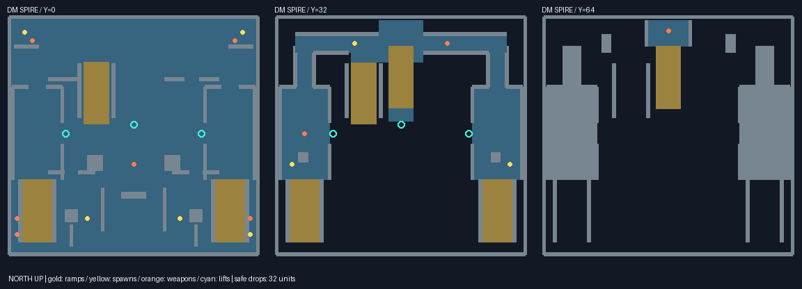

# DM SPIRE

Original sealed reactor outpost: west and east towers bracket a courtyard;
a north spire carries a high gallery. Ten protected spawns and eight pickups
span y=0, 32 and 64. Three gravity lifts reach the middle level. Four ramps
provide alternate travel: two tower ramps, the north ground ramp, and the
upper ramp. North dogleg halls connect the towers to railed bridges;
hanging baffles interrupt views from above. Drop one band at a time (32
units) for a safe descent. The ground dividers have openings at both ends
and doorways through their middle, providing routes around the reactors.

General arena principles (vertical loops, alternate approaches, contested
weapons, flankable cover) inspired the design. No Lockout geometry, external
reference map, proprietary archive, xopsdata, or proprietary derivative was
used. Textures are byte-identical copies of the existing generated CC0
`data/ufoescape` textures. Asset hashes and source paths are recorded only
in the root `PROVENANCE-ADD.jsonl` integration sidecar.



Gold is ramp geometry, yellow is a DM spawn, orange is a pickup, and cyan
is a gravity lift. Plans show the three height bands; grey includes walls
and overhead structures intersecting player height.

Regenerate from the repository root:

```sh
python3 tools/rebuild_maps.py
python3 -c 'from pathlib import Path; from tools.artgen.briefing_pictures import generate_dmspire, generate_spire_layout; generate_dmspire(Path("assets/pack/data/briefing")); generate_spire_layout(Path("docs/img/dm/spire_layout.png"))'
python3 tools/dmcheck.py data/dmspire spire.pd1 --sealed
python3 -W ignore -m unittest discover -s tools/tests
```

The tower ramp lanes are clear of the south court crates and spawn screens,
which now sit at x=±80. The south shell extends to z=156, leaving more than
12 units of floor beyond each tower ramp toe. The ground spire ramp runs
at x=-48, beside the upper ramp, with a 12-unit landing and an opening in
the west bridge rail. The reactors sit south of the ground ramp entrance;
the bridge baffles move outward and start at y=60 for 28 units of clearance
above the bridge. Towers, both bridges, four ramps and three lifts remain.

Source regression checks cover all four ramp surfaces and 12 units beyond
both ends: clear floor at the ends and at least 28 units of headroom.
The sealed real-engine gate remains mandatory and walks every ramp both ways.

Measured native engine gate (2026-10-22): 73 blocks, 7,828 standing spots,
102,800 units of connected play area, four walkable ramps; all three lifts
settle at y=32.3. Sightline fraction 0.231, worst spawn exposure 0.22,
trapped fraction 0.0000, ambiguous ledges 0, void leaks 0 (2,142 samples).
Result: `DMCHECK OK`. No thresholds or engine/gate sources were changed.

Browser play and visual verification were not performed.

Validation on 2026-10-22:

- `python3 tools/geomcheck.py --all`: zero visible coplanar overlaps in every map.
- Pack validator: `RESULT: OK  (0 failures, 360 warnings)`.
- Full unittest discovery: `Ran 315 tests in 36.118s`,
  `FAILED (failures=2, errors=1)`. The font atlas cannot download the
  Shinonome tarball (DNS unavailable); the unchanged HANGAR map fails the
  ramp gate for blocks 42, 45 and 48 (bottom ends blocked); protocol testing
  hits LeakSanitizer's sandbox/ptrace restriction.
- Required rerun with `ASAN_OPTIONS=detect_leaks=0 LSAN_OPTIONS=detect_leaks=0`
  of protocol and SPIRE tests: `Ran 7 tests in 2.140s`, `OK`.
  This verifies protocol assertions without checking leaks.

Exact sealed SPIRE gate output:

```text
METRIC blocks 73
METRIC extent_x 324
METRIC extent_z 310
METRIC extent_y 114
METRIC standing_spots 7828
METRIC floor_area 125248
METRIC dm_spawns 10
METRIC pickups 8
METRIC lifts 3
METRIC lift_0_peak 34.9
METRIC lift_0_rest_y 32.3
METRIC lift_1_peak 34.9
METRIC lift_1_rest_y 32.3
METRIC lift_2_peak 34.9
METRIC lift_2_rest_y 32.3
METRIC play_spots 6425
METRIC play_area 102800
METRIC trapped_fraction 0.0000
METRIC sightline_fraction 0.231
METRIC longest_sightline 347
METRIC spawn_0_exposure 0.18
METRIC spawn_1_exposure 0.22
METRIC spawn_2_exposure 0.01
METRIC spawn_3_exposure 0.01
METRIC spawn_4_exposure 0.13
METRIC spawn_5_exposure 0.14
METRIC spawn_6_exposure 0.09
METRIC spawn_7_exposure 0.20
METRIC spawn_8_exposure 0.20
METRIC spawn_9_exposure 0.22
METRIC worst_spawn_exposure 0.22
METRIC ambiguous_ledges 0
METRIC walkable_ramps 4
METRIC void_leaks 0 (from 2142 spots)
DMCHECK OK
```

Commit was attempted but Git could not create
`/home/ivy/Work/xops-online/.git/worktrees/fix-spire-ramps/index.lock`:
`Read-only file system`. Changes remain uncommitted in this worktree;
no push was attempted.
