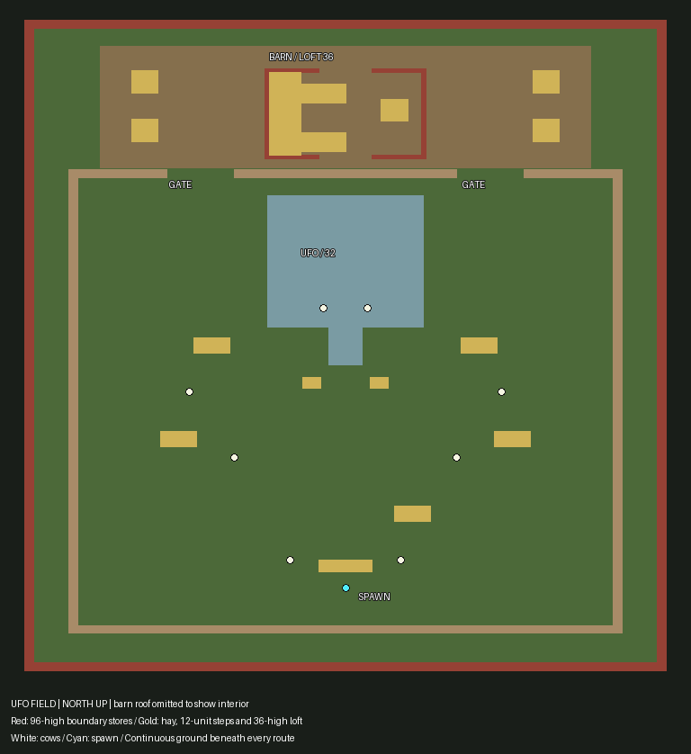

# UFO FIELD farmyard validation — 2026-10-22

Original clean-room content; no proprietary source data used. All map binaries
rebuilt only with `python3 tools/rebuild_maps.py`; `--check` succeeds.

Continuous ground replaces the island. The outer shell is four solid barn-red
96-high walls representing farm stores, not detailed buildings or vegetation.
Two 60-wide pasture gates flank the unchanged UFO. Both barn doors are open;
the west loft is 36 high, reached by two routes with 12-unit hay rises. Its
underside is 34 above ground; the roof underside is 44 above the loft.
New yard hay breaks up the northern flank. The original pasture fighting
space, UFO/ramp, cows, mission events, alien staging and routes are preserved.
Mission and DM point lists were compared with HEAD and are identical.

The roof-cutaway image is generated by
`tools.artgen.briefing_pictures.generate_ufofield_layout` and is also refreshed
by the briefing-picture script's main entry point:



## Exact engine gate output

`python3 tools/dmcheck.py data/ufofield ufo.pd1 --mission --outdoor`

```text
METRIC blocks 57
METRIC extent_x 576
METRIC extent_z 696
METRIC extent_y 104
METRIC standing_spots 24419
METRIC floor_area 390704
METRIC dm_spawns 0
METRIC pickups 15
METRIC lifts 0
METRIC play_spots 21575
METRIC play_area 345200
METRIC trapped_fraction 0.0000
METRIC sightline_fraction 0.333
METRIC longest_sightline 647
METRIC worst_spawn_exposure 0.00
METRIC ambiguous_ledges 0
METRIC walkable_ramps 0
METRIC death_pit_edges 0
DMCHECK OK
```

`python3 tools/dmcheck.py data/dmfield field.pd1 --outdoor`

```text
METRIC blocks 57
METRIC extent_x 576
METRIC extent_z 696
METRIC extent_y 104
METRIC standing_spots 24419
METRIC floor_area 390704
METRIC dm_spawns 10
METRIC pickups 7
METRIC lifts 0
METRIC play_spots 21575
METRIC play_area 345200
METRIC trapped_fraction 0.0000
FAIL pickup 2 at (-56,2,-98) is not on a standing spot
FAIL pickup 3 at (56,2,-98) is not on a standing spot
METRIC sightline_fraction 0.333
METRIC longest_sightline 647
METRIC spawn_0_exposure 0.52
FAIL spawn 0 at (-100,2,120) is visible from 52% of the map
METRIC spawn_1_exposure 0.40
FAIL spawn 1 at (100,2,120) is visible from 40% of the map
METRIC spawn_2_exposure 0.39
FAIL spawn 2 at (-150,2,70) is visible from 39% of the map
METRIC spawn_3_exposure 0.34
METRIC spawn_4_exposure 0.41
FAIL spawn 4 at (-100,2,-20) is visible from 41% of the map
METRIC spawn_5_exposure 0.46
FAIL spawn 5 at (100,2,-20) is visible from 46% of the map
METRIC spawn_6_exposure 0.52
FAIL spawn 6 at (0,2,160) is visible from 52% of the map
METRIC spawn_7_exposure 0.49
FAIL spawn 7 at (0,2,60) is visible from 49% of the map
METRIC spawn_8_exposure 0.48
FAIL spawn 8 at (-60,2,-70) is visible from 48% of the map
METRIC spawn_9_exposure 0.41
FAIL spawn 9 at (60,2,-70) is visible from 41% of the map
METRIC worst_spawn_exposure 0.52
METRIC ambiguous_ledges 0
METRIC walkable_ramps 0
METRIC death_pit_edges 0
DMCHECK FAILED (11)
```

DM FIELD's full deathmatch gate remains red: exposure failures are out of scope;
two unchanged pickups beside the UFO also lack standing spots. Its requested
outdoor death-pit metric is zero. Spawns and pickups were not moved.

## Tests and validation

Required unmodified discovery command:
`python3 -W ignore -m unittest discover -s tools/tests`

```text
Ran 316 tests in 37.257s
FAILED (failures=3, errors=1)
```

LeakSanitizer fails under this sandbox/ptrace environment. Requested rerun:
`ASAN_OPTIONS=detect_leaks=0 LSAN_OPTIONS=detect_leaks=0 python3 -W ignore -m unittest tools.tests.test_net_protocol`

```text
.
----------------------------------------------------------------------
Ran 1 test in 1.770s

OK
```

Full discovery repeated with the same leak-detection override:

```text
Ran 316 tests in 37.027s
FAILED (failures=2, errors=1)
```

Remaining failures are `test_rebuilt_hangar_passes_sealed_engine_gate` and
`test_sealed_engine_gate` (SPIRE): their ramp gate failures reproduce on
binaries byte-identical to HEAD. No source or binaries for those maps changed.
The error is `test_char_atlas.CharAtlasTest.setUpClass`: fetching the pinned
Shinonome font tarball fails with `Temporary failure in name resolution`.
These unrelated maps and network-dependent font generation were not changed.
No tests or thresholds were weakened or deleted.

The unmodified UFO engine harness passes waves, completion, cow body collision,
exposed-player survival pressure, ramp descent and all its other assertions.
The UFO FIELD tests, including the new mission/outdoor regression gate, pass.

`python3 -W ignore -m unittest tools.tests.test_ufo_field tools.tests.test_ufo_engine`:

```text
Ran 19 tests in 14.282s
OK
```

`python3 tools/geomcheck.py --all`: every map has **0 visible coplanar overlaps**.

`python3 tools/validate_pack.py assets/pack --provenance assets/provenance.jsonl`:

```text
RESULT: OK  (0 failures, 360 warnings)
```

Changed pack map binaries and briefing pictures have refreshed provenance hashes.
Existing procedural textures are reused; no new texture assets were needed.

## Commit limitation

The requested `git add` and `git commit` were attempted, but both failed:

```text
fatal: Unable to create '/home/ivy/Work/xops-online/.git/worktrees/ufo-field-v2/index.lock': Read-only file system
```

The environment does not permit an approval escalation. Changes remain saved
in this worktree, uncommitted. No push was attempted and no other worktree was
modified. Current HEAD (not a commit of these changes) is
`a3b1b86e672891fed5fd9affba093a4072be8964`.
